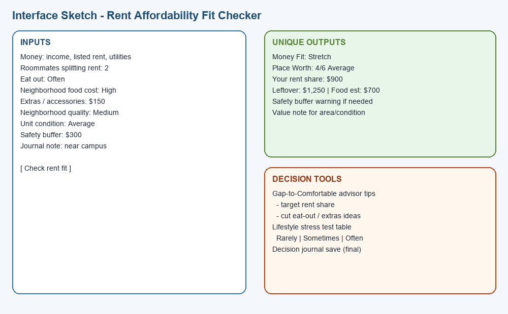
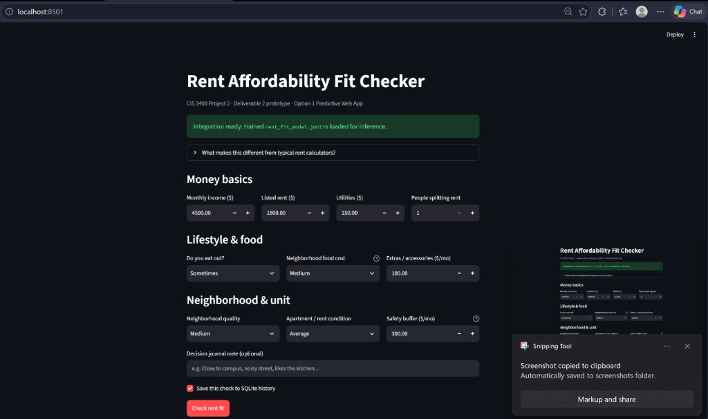

# CIS 3400 – Advanced Programming
## Project 2: Python Application Development

**Student Name:** Antriksh Gupta  
**Project Title:** Rent Affordability Fit Checker  
**Course:** CIS 3400 – Advanced Programming  
**Final Presentation:** December 8, 2026

**Deliverable 3 (Final):** Completed app + README + testing evidence + AI statement + presentation materials.

**GitHub:** https://github.com/agupta362/rent-affordability-fit-checker

### Deploy on Streamlit Community Cloud (public web link)
1. Open [https://share.streamlit.io](https://share.streamlit.io) and sign in with **GitHub** (`agupta362`)
2. Click **Create app** → **Yup, I have an app**
3. Set:
   - **Repository:** `agupta362/rent-affordability-fit-checker`
   - **Branch:** `master`
   - **Main file path:** `app.py`
4. Optional: pick a custom subdomain (e.g. `rent-fit-checker`)
5. Click **Deploy**

After deploy, your public link will look like:
`https://<your-subdomain>.streamlit.app`

Paste that URL into Section 11 below once Cloud finishes building.

---

## Deliverable 3 — Submission Checklist

| Requirement | Location |
|---|---|
| 1. GitHub link + full repo + README | this repository |
| 2. Completed app | `streamlit run app.py` |
| 3. Testing evidence | `docs/TESTING.md`, `tests/test_rent_predictor.py`, `docs/prototype_metrics.txt` |
| 4. AI use statement | Section 8 below + `docs/AI_USE_STATEMENT.md` |
| 5. Presentation | `docs/CIS3400_Deliverable3_Presentation_Gupta.pptx` + `docs/PRESENTATION_SCRIPT.md` |

### Run the completed app
```bash
cd rent-affordability-fit-checker
pip install -r requirements.txt
streamlit run app.py
```

### Run automated tests
```bash
python -m unittest tests.test_rent_predictor -v
```

---

## 1. Project Overview

**Application Name:** Rent Affordability Fit Checker

**Project Option:** Predictive ML Application (Option 1 – Predictive Web Application)

### Problem Statement
Students and early-career renters often struggle to judge whether an apartment truly fits their life—not just the rent number. Typical websites apply a blunt 30% rent rule and ignore eat-out habits, neighborhood food prices, extras, roommates, and whether the area/unit is worth paying for. This application predicts a rent-fit label—**Comfortable**, **Stretch**, or **Too High**—using money basics plus lifestyle and place context, then adds decision tools most calculators lack (dual scores, reverse advice, stress tests, listing compare, and SQLite journal history). Results are planning guidance only, not financial advice.

### Intended Users
Students, interns, and early-career renters comparing apartments—especially people with roommates or lifestyle spending that a generic calculator misses.

### Unique Features
1. **Lifestyle-adjusted affordability assessment**
2. **Dual scoring system** — Money Fit + Place Worth
3. **Lifestyle stress testing** (Rarely / Sometimes / Often)
4. **Gap-to-Comfortable advisor**
5. **Roommate share mode**
6. **Student safety-buffer warning**
7. **Decision journal + filtered SQLite history + leftover trend chart**
8. **Side-by-side listing compare**
9. **Quick lifestyle presets** (student / intern)

## 2. Application Features

- Money, lifestyle, and place inputs with validation
- Model-backed Money Fit prediction + Place Worth score
- Advisor, stress test, compare listings
- SQLite save/history with label filter, note search, and trend chart
- Optional journal note on each saved check

**User flow:** choose preset (optional) → fill form → **Check rent fit** → review dual scores / advisor / stress test → optionally compare listings → filter history.

## 3. Technologies Used

| Technology | Purpose |
|---|---|
| Python | Application logic and classes |
| Streamlit | Interactive web UI |
| Pandas | Feature tables / history charts |
| scikit-learn | Random Forest classifier |
| joblib | Save/load trained model |
| SQLite | Prediction / journal history |
| unittest | Automated testing |

## 3b. Synthetic Data Design

Training uses ~1000 synthetic rows with documented rules (see earlier Deliverable 1/2 notes):

- Sample income, rent/roommates, utilities, eat-out, food-cost band, extras, quality, condition
- Derive food spend, housing cost, burden ratios, place worth
- Label `fit_label`: Comfortable / Stretch / Too High from burden bands (+ weak-place nudge)
- Required fields must be present at prediction time; app does not silently impute required inputs

Details: training script `notebooks/train_model_starter.py`

## 4. Application Architecture


### How the Application Works
1. User enters money/lifestyle/place inputs (or a preset).
2. `app.py` passes values to `RentFitPredictor`.
3. Class validates inputs and builds features (rent share, food estimate, burden, worth).
4. Loads `models/rent_fit_model.joblib` and predicts Money Fit (+ probabilities).
5. Displays dual scores, advisor, stress test; can compare two listings.
6. Optionally saves to SQLite; history supports filter/search/trend chart.

### Modules / classes

| Component | Role |
|---|---|
| `app.py` | Final Streamlit UI |
| `rent_predictor.py` / `RentFitPredictor` | Validate, features, predict, advisor, stress test |
| `database.py` | SQLite save/list/filter/summary |
| `notebooks/train_model_starter.py` | Train/export model |
| `tests/test_rent_predictor.py` | Automated tests |
| `models/rent_fit_model.joblib` | Trained model |

## 5. Project Structure

```text
rent-affordability-fit-checker/
├── app.py
├── rent_predictor.py
├── database.py
├── requirements.txt
├── README.md
├── models/rent_fit_model.joblib
├── notebooks/train_model_starter.py
├── tests/test_rent_predictor.py
├── data/
└── docs/
    ├── architecture.png
    ├── TESTING.md
    ├── AI_USE_STATEMENT.md
    ├── PRESENTATION_SCRIPT.md
    ├── CIS3400_Deliverable3_Presentation_Gupta.pptx
    └── prototype_main_screen.png
```

## 6. Installation and Running

```bash
git clone https://github.com/agupta362/rent-affordability-fit-checker.git
cd rent-affordability-fit-checker
python -m venv .venv
.venv\Scripts\activate
pip install -r requirements.txt
streamlit run app.py
```

Retrain only if needed:
```bash
python notebooks/train_model_starter.py
```

No API keys required.

## 7. Testing and Validation

Full write-up: [`docs/TESTING.md`](docs/TESTING.md)

| Test | Expected | Actual |
|---|---|---|
| Model loads | joblib available | Pass |
| Normal prediction | Model-backed label + probabilities | Pass |
| Invalid income / negative rent | Clear error | Pass |
| Roommate share | Shared leftover > solo leftover | Pass |
| Eat-out Often vs Rarely | Higher food spend when Often | Pass |
| Stress test | 3 rows | Pass |
| SQLite filter/search | Saved note/label recoverable | Pass |
| Listing compare (manual UI) | Side-by-side metrics | Pass |

Model metrics: [`docs/prototype_metrics.txt`](docs/prototype_metrics.txt)

**Limitation:** synthetic labels follow documented burden rules (educational). Not real lending advice.

## 8. AI-Assisted Development Disclosure

**AI Tools Used:** ChatGPT, Cursor, GitHub Copilot

### How AI Was Used
AI assisted with Streamlit/class scaffolding, SQLite helper patterns, debugging feature-order issues, and documentation wording across deliverables.

### Student Contributions
I defined the problem and unique features, chose Option 1, designed architecture and labeling rules, aligned training/inference features, built final history/compare/preset features, wrote/ran tests, and prepared the final presentation.

### AI component tested/modified
Early AI-assisted predictor/UI code was modified to load joblib payloads correctly, match feature order, return probabilities, and connect SQLite history filters in the final app.

**Student statement:** I reviewed, tested, and can explain the code and technologies used in my application, including code developed with AI assistance.

Full copy: [`docs/AI_USE_STATEMENT.md`](docs/AI_USE_STATEMENT.md)

## 9. Challenges and Lessons Learned

**Challenge 1:** Rent-only rules miss lifestyle reality.  
**Solution:** Lifestyle-adjusted burden + dual Money Fit / Place Worth scoring.

**Challenge 2:** Feature order mismatch between notebook and app.  
**Solution:** Export feature list inside the joblib payload; build inference rows from that list.

**Challenge 3:** History needed to be useful, not just stored.  
**Solution:** Label filter, note search, and leftover trend chart.

Skills practiced: class-based ML packaging with Streamlit, SQLite persistence, unittest evidence, and clear demo architecture.

## 10. Application Screenshots





## 11. Project Links

**GitHub Repository:** https://github.com/agupta362/rent-affordability-fit-checker  
**Deployed Application:** Streamlit Community Cloud — deploy from GitHub (see top of README); update this line with your `*.streamlit.app` URL after deploy  
**Local run:** `streamlit run app.py`  
**Presentation:** [`docs/CIS3400_Deliverable3_Presentation_Gupta.pptx`](docs/CIS3400_Deliverable3_Presentation_Gupta.pptx)  
**Presentation script:** [`docs/PRESENTATION_SCRIPT.md`](docs/PRESENTATION_SCRIPT.md)

## 12. Future Improvements

1. Optional real rent/income open-data enrichment by city band  
2. Export saved history to CSV from the UI  
3. Deploy Streamlit Cloud version for easier instructor access  

---

### Documentation Timeline

- **Deliverable 1 – Nov 16:** Proposal / design README sections  
- **Deliverable 2 – Nov 23:** Working prototype + integrations + status  
- **Deliverable 3 – Dec 8:** Completed app, testing evidence, AI statement, presentation  
