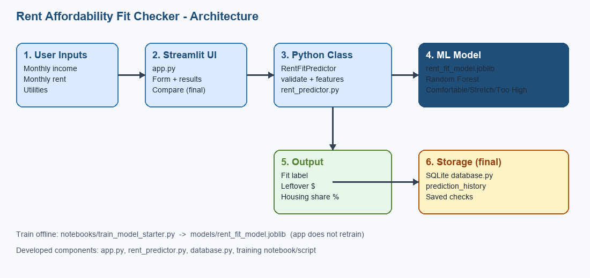

# CIS 3400 – Advanced Programming
## Project 2: Python Application Development

**Student Name:** Antriksh Gupta  
**Project Title:** Rent Affordability Fit Checker  
**Course:** CIS 3400 – Advanced Programming  
**Final Presentation:** December 8, 2026

**Deliverable 1 proposal (Word):** [`docs/CIS3400_Deliverable1_Rent_Affordability_Gupta.docx`](docs/CIS3400_Deliverable1_Rent_Affordability_Gupta.docx)

---

## 1. Project Overview

**Application Name:** Rent Affordability Fit Checker

**Project Option:** Predictive ML Application (Option 1 – Predictive Web Application)

### Problem Statement
Students and early-career renters often struggle to judge whether an apartment truly fits their monthly budget. Listing sites show rent, but they rarely translate income, rent, and utilities into a clear affordability signal. This application predicts a rent-fit label—**Comfortable**, **Stretch**, or **Too High**—and estimates leftover money after housing costs. It helps users compare listings quickly before they overcommit. Results are planning guidance only, not financial advice.

### Intended Users
Students, interns, and early-career renters who are comparing apartments. They will enter a few budget numbers, see a fit label and leftover estimate, and (in the final version) compare listings and review saved checks.

### Unique Features
Unlike classroom ML notebooks, this is a form-based Streamlit app focused on a personal decision. Unlike a simple rent calculator, it uses a trained classification model, supports scenario comparison, and stores prediction history in SQLite. The interface stays small: only three required inputs.

## 2. Application Features

- **Feature 1:** Enter monthly income, rent, and utilities; get a fit label (Comfortable / Stretch / Too High).
- **Feature 2:** Show estimated leftover cash and housing share of income.
- **Feature 3:** Input validation and clear messages for invalid or missing values.
- **Feature 4 (final):** Compare two listings side by side and save prediction history in SQLite.

Users interact through a short Streamlit form, click **Check rent fit**, and receive a label plus leftover estimate. In the final app they can compare another listing and view past checks.

## 3. Technologies Used

| Technology | Purpose |
|---|---|
| Python | Main programming language and application logic |
| Streamlit | Web interface and form-based UI |
| Pandas | Build/clean training examples and feature tables |
| scikit-learn | Train Random Forest (or similar) rent-fit classifier |
| joblib | Save and load the trained model |
| SQLite | Store prediction history (final) |
| Matplotlib | Optional charts of saved prediction history (final) |

## 4. Application Architecture



### How the Application Works

1. The user enters monthly income, rent, and utilities.
2. The Streamlit interface (`app.py`) passes the values to Python.
3. The `RentFitPredictor` class validates inputs and builds features (including rent-to-income ratio).
4. The application loads `models/rent_fit_model.joblib` and runs classification inference.
5. The fit label, leftover amount, and housing share are displayed to the user.
6. In the final version, the result can be saved to SQLite through `database.py`.

Training happens offline in `notebooks/` and exports the joblib file. The web app does not retrain on each prediction.

## 5. Project Structure

```text
rent-affordability-fit-checker/
├── app.py
├── rent_predictor.py
├── database.py
├── requirements.txt
├── README.md
├── models/
│   └── rent_fit_model.joblib          # created after training
├── notebooks/
│   ├── README.md
│   └── train_model_starter.py         # convert/expand to train_model.ipynb
├── data/
│   └── rent_fit_training.csv          # generated locally; not committed
└── docs/
    ├── architecture.png
    ├── CIS3400_Deliverable1_Rent_Affordability_Gupta.docx
    └── DELIVERABLE1_CHECKLIST.md
```

**Important files**
- `app.py` — Streamlit UI
- `rent_predictor.py` — `RentFitPredictor` class (validate, features, predict)
- `database.py` — SQLite helpers for history (final)
- `notebooks/train_model_starter.py` — training starter that exports the joblib model
- `docs/architecture.png` — architecture diagram
- `docs/CIS3400_Deliverable1_Rent_Affordability_Gupta.docx` — Deliverable 1 proposal

## 6. Installation and Running the Application

### Step 1: Clone the repository

```bash
git clone https://github.com/agupta362/rent-affordability-fit-checker.git
cd rent-affordability-fit-checker
```

### Step 2: Install dependencies

```bash
python -m venv .venv
# Windows:
.venv\Scripts\activate
pip install -r requirements.txt
```

### Step 3: Train the model (before full ML inference)

```bash
python notebooks/train_model_starter.py
```

This writes `models/rent_fit_model.joblib` and a local training CSV under `data/`.

### Step 4: Run the application

```bash
streamlit run app.py
```

**Notes**
- Current scaffold includes a rule-based preview so the UI runs before the joblib model is fully wired.
- No API keys or secrets are required. Do not commit `.env` files or credentials.

## 7. Testing and Validation

| Test | Expected Result | Actual Result |
|---|---|---|
| Normal user input (e.g., income 4500, rent 1800, utilities 150) | Fit label + leftover shown | Pending — Deliverable 2 |
| Invalid or missing input (blank / negative values) | Helpful error message | Pending — Deliverable 2 |
| Model interaction after training | Label from saved joblib model | Pending — Deliverable 2 |
| History / compare feature | Saved or compared results display | Pending — final |

**Known limitations (Deliverable 1):** Labels are based on documented rent-to-income style rules using synthetic training examples. This is educational guidance, not professional financial advice. Full model-backed inference and formal test evidence come in later deliverables.

## 8. AI-Assisted Development Disclosure

**AI Tools Used:** ChatGPT, Cursor, GitHub Copilot (planned / in use for scaffolding)

### How AI Was Used
AI assistance is planned for class structure, Streamlit form wiring, SQLite helpers, debugging, and README/documentation wording. For Deliverable 1, AI helped draft the proposal structure, repository scaffold, and architecture wording.

### Student Contributions
I defined the problem (rent fit for students/early-career renters), chose Option 1, selected the three-input design, planned the architecture (`app.py` → `RentFitPredictor` → joblib → SQLite), and will own labeling rules, integration, testing, and explanation of the final code.

**Student statement:** I reviewed, tested, and can explain the code and technologies used in my application, including code developed with AI assistance.

## 9. Challenges and Lessons Learned

**Challenge 1:** Keeping the UI simple while still meeting Option 1 ML requirements.  
**Solution (planned):** Only three user inputs; richer features (like rent-to-income) are computed inside the predictor class.

**Challenge 2:** Making Comfortable / Stretch / Too High explainable.  
**Solution (planned):** Document labeling rules in the training notebook and show housing share with every prediction.

New skills to develop: packaging a trained model with Streamlit, class-based prediction design, and SQLite history for a small decision app.

## 10. Application Screenshots

Screenshots will be added for Deliverable 2 / final:

1. Main application interface
2. Application showing a working prediction result

```markdown


```

## 11. Project Links

**GitHub Repository:** https://github.com/agupta362/rent-affordability-fit-checker  
**Deployed Application:** N/A (local Streamlit for now)  
**Demonstration Video:** N/A (final presentation Dec 8)

## 12. Future Improvements

1. Wire the Streamlit app fully to the trained joblib model (replace preview rules).
2. Add listing compare + SQLite history chart for the final submission.
3. Optional city cost band input if it improves model usefulness.

---

### Documentation Timeline

- **Deliverable 1 – November 16:** Complete the project overview, planned features, proposed technologies, preliminary architecture diagram, and planned project structure. These are planning sections and may change as development progresses.
- **Deliverable 2 – November 23:** Update the README to reflect implementation progress and initial testing.
- **Final Deliverable – December 8:** Complete all sections, verify setup instructions, add screenshots, and provide final links.
